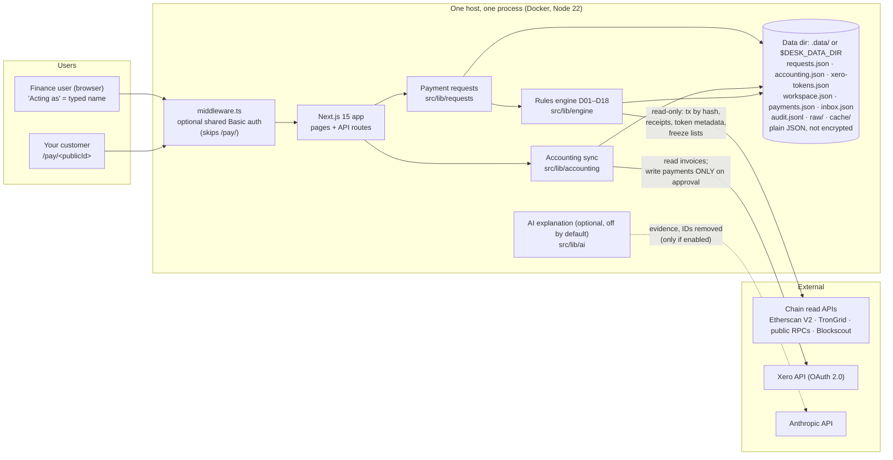

# Architecture (one page)

## Components

| Component | What it is | Where |
|---|---|---|
| Next.js app | Next.js 15 / React 19, server-rendered pages and API routes, one Node process. Port 3000, HTTP; TLS comes from the host. | `src/app/`, `Dockerfile` |
| Middleware | Optional HTTP Basic auth on every route except the customer's payment page. Not a login system. | `src/middleware.ts` |
| Rules engine | Pure functions, one per diagnosis code (wrong network, counterfeit token, issuer freeze, short, ...). Verdicts are computed on the server only. | `src/lib/engine/` |
| Payment requests | Request per invoice, customer payment page with look-alike address checker, matching of transfers to requests, decisions and activity (append-only). | `src/lib/requests/` |
| JSON data dir | All state as JSON files, written atomically (temp file + rename) under a per-file lock in one process. No database yet; run one process per data dir. | `src/lib/data-dir.ts`, `src/lib/lock.ts` |
| Chain access | Read-only fetchers: Ethereum, Polygon, Arbitrum (Etherscan V2 or public RPC), Tron (TronGrid), BNB Chain, Base, Optimism (public RPC). Lookups by transaction hash. Rate limits and retries per host; raw responses kept with SHA-256. **No address watching**: a payment is found when someone gives its hash. | `src/lib/chain/`, `src/lib/requests/provider.ts` |
| Xero OAuth | Authorisation-code flow with a `state` cookie; tokens saved to `xero-tokens.json`; refresh inside a file lock. Reads `ACCREC` invoices, posts payments / credit notes / bank transactions on approval. QuickBooks built against docs, not run; NetSuite designed only. | `src/lib/accounting/providers/` |
| Audit | Posting audit inside `accounting.json`; operational audit in `audit.jsonl` (actor, time, IP). Application-level append-only. | `src/lib/accounting/service.ts`, `src/lib/payments/audit.ts` |
| Demo mode | Default unless `DEMO_MODE=off`. Fictional company, simulated transfers labelled "simulated", demo books instead of Xero, no network needed. `DEMO_MODE=1` also refuses uploads and imports. | `src/lib/mode.ts`, `src/lib/demo/`, `src/lib/requests/demo.ts` |
| AI explanation | Optional: Claude writes a paragraph for a verdict code already decided; validated, falls back to template text. Off in the Docker image. | `src/lib/ai/` |

## Demo vs live: what differs

| | Demo (default) | Live (`DEMO_MODE=off`) |
|---|---|---|
| Transfers | Simulated, triggered by demo controls | Real Ethereum tx looked up by a hash someone pastes |
| Auto-mark paid | On for demo requests | **Off**: a person marks paid |
| Books | Fictional demo books in `accounting.json` | Xero, after connecting |
| Chains for requests | Ethereum (USDC, USDT) | Ethereum (USDC, USDT) |
